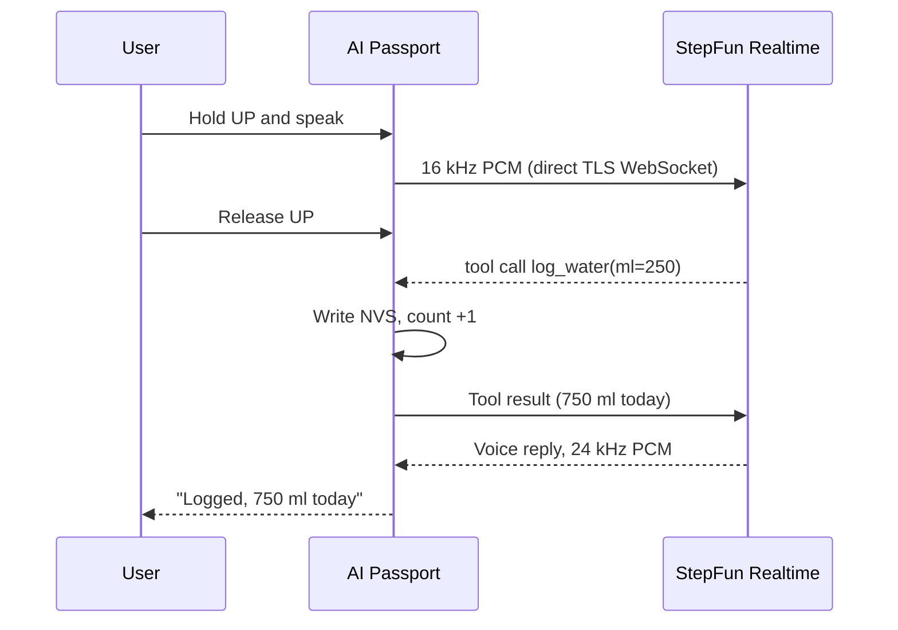

<p align="right">
  <a href="README.zh_CN.md">简体中文</a> · <strong>English</strong>
</p>

# Passport Health Buddy

An always-on health companion you wear. At work it reminds you to stand up and drink water; at the gym one sentence logs a set and starts the rest timer; at home it leads planks and interval workouts. Hold a button and speak: a StepFun Step realtime voice model understands and acts.

Hardware is the FoloToy AI Passport: ESP32-C3, 240 × 320 color screen, three keys, microphone and speaker, NFC, 500 mAh battery.

## Three modes

| Mode | You | The device |
| --- | --- | --- |
| Everyday | Work as usual | Stand-up reminder every 45 minutes, timed hydration reminders; say "half a bottle" to log millilitres |
| Gym | Hold UP and say "bench press 60 kg, 8 reps" | Logs the set at once (undo within 5 seconds), starts a 90-second rest countdown |
| Home | Pick plank or an interval plan | Start cues and on-screen countdown keep the pace; records persist in Flash across power loss |

In the evening the same realtime voice session reads out the day's report while the screen shows it.

## How Step models are used



- Model: `stepaudio-3-realtime-preview` (StepAudio 3 Realtime), fallback `step-audio-2`; endpoint `wss://api.stepfun.com/v1/realtime`.
- Push-to-talk: release sends `commit` + `response.create`; server VAD stays off.
- Tool calls: `log_water`, `log_set`, `start_rest_timer`, `start_interval_plan`, `snooze_reminder`, `query_today`. The device writes first and returns the result, so the model speaks real device data.
- The device talks to StepFun directly, with no laptop or server relay. On first boot, join the device hotspot from a phone and open `192.168.4.1` to enter Wi-Fi and the API key; the key lives only in device NVS.

Full design: [Wearable health companion](docs/health-companion.md).

## Layout

```text
main/                  Application: modes, timers, reminders, provisioning, voice session, UI
components/bsp/        Board drivers: display, keys, audio, battery
tests/                 Host tests: timer state machine, storage, layout
tools/validate.sh      Repo checks + host tests + firmware build
docs/                  Product docs, hardware reference, developer guides
```

## Build

Requires ESP-IDF 5.5.3.

```bash
./tools/validate.sh --static    # repo checks + host tests
./tools/validate.sh --firmware  # firmware build + merged-image check
```

Read the [firmware layout](docs/development/engineering/firmware-layout.md) before flashing: a merged image written from `0x0` overwrites NVS, including stored Wi-Fi, API key, and training records.

Development plan and status: [docs/plan.md](docs/plan.md).

## Documentation

- [Wearable health companion](docs/health-companion.md): product shape, voice path, hardware limits
- [Development plan](docs/plan.md): architecture decisions, measurements, schedule, acceptance
- [Plank free timer](docs/plank-trainer.md) (Chinese): keys, cues, record semantics
- [Hardware specification](docs/hardware-design/specifications.md)
- [Developer documentation index](docs/README.md): development rules and BSP notes from upstream AI Passport

## Credits

- [FoloToy/ai-passport](https://github.com/FoloToy/ai-passport): BSP and development framework (MIT).
- [kunlun322/Qoder-Passport](https://github.com/kunlun322/Qoder-Passport): provisioning, Wi-Fi, TLS memory tuning, and the realtime voice pipeline (MIT).

Entry for the 2026 StepFun Hackathon.
