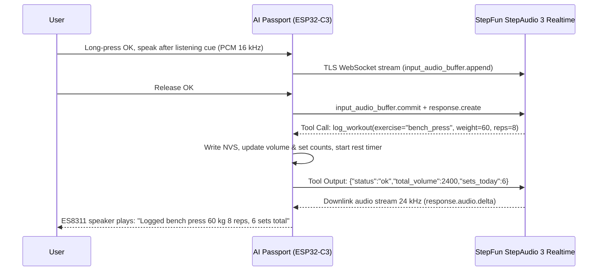

<p align="right">
  <a href="README.zh_CN.md">简体中文</a> · <strong>English</strong>
</p>

# Passport Health Buddy

An intelligent health companion worn on your chest or placed on your desk. It schedules activity and hydration reminders at work, logs strength sets and runs rest timers at the gym, and supports HIIT intervals and planks at home. Activity reminders follow a time cycle; the device does not detect posture or standing up.

Powered by the **StepFun StepAudio 3 Realtime Voice Model**, 8 on-device tools directly drive hardware states. Featuring a pure local state machine with Flash non-volatile memory, it eliminates smartphone dependency on an ultra-compact screen.

Built on the **FoloToy AI Passport** (ESP32-C3, 240 × 320 color display, 3 tactile buttons, microphone and speaker, 500 mAh battery).

---

## Hardware & On-Screen UI Preview

Every page uses the same card grammar: a header row (page title, mute marker, battery) above a divider, one large reading, at most two supporting lines, and a status pill. Below sit a voice bar and one primary-action line. Home shows only the centered stopwatch and one hint, without rotating history. Full button instructions live on the `?` Help page.


---

## Quick Start: How to Use

### 1. Physical Buttons & Gestures

The physical button order from top to bottom is **UP → DOWN → OK**. Gestures are consistent across modes:

| Button | Short press (on release) | Long press (about 0.5 seconds) |
| --- | --- | --- |
| UP | Raise output volume by 10 percentage points | Previous page |
| DOWN | Lower output volume by 10 percentage points, down to mute | Next page |
| OK | Perform the current page's primary action | Speak after the listening cue; release to send |

Each hold triggers once, with no short action on release. No double-clicks or chords. Short OK logs 250 ml in Office, starts or ends a 90-second rest in Gym, and starts, cancels preparation, or ends the plank timer in Home. With an active interval plan it ends that workout.

Pages wrap through Office → Gym → Home → `?`. Paging to `?` shows help; short OK returns to the previous business page. No extra gesture or interruption to exercise is required.

Volume affects both speech and cues and is saved about one second after adjustment stops. Mute does not disable the microphone. Paging preserves timers; voice records do not change the selected page. Activity reminders dismiss themselves without standing acknowledgements. There is no physical undo action.

Preparation/start retain the original 1000 / 2000 Hz signals at about 3.5 dB lower amplitude. Other cues use softer synthesis, including an ascending minute arpeggio. See [sound and playback rules](docs/health-companion.md#sound-and-playback-rules).

For voice debugging, [per-utterance traces](docs/health-companion.md#5-per-utterance-traces-and-prompt-debugging) join recognition, responses, tool execution and storage with a prompt/tool configuration fingerprint. Run `python tools/voice-trace.py capture --help` for bounded local serial capture.

---

### 2. Voice Commands (StepAudio 3 Natural Language Capabilities)

Long-press OK, speak naturally after the listening cue, and release to send. Wait for the current reply to finish before starting the next utterance.

#### ① Gym Strength Tracking (23 Whitelisted Exercises, Multi-sets, Auto Units & Error Correction)
- **Direct logging**: "Bench press 60 kg 8 reps", "Squat 100 kg 5 reps for 3 sets", "Seated cable row 45 kg 12 reps", "Pull-ups bodyweight 10 reps".
- **Per-side barbell calculation**: "Barbell press 20 kg each side for 8 reps" ➔ *Model computes `20×2 + 20(bar) = 60 kg`*.
- **Pounds to kilograms**: "Dumbbell press 50 lbs 10 reps" ➔ *Model automatically converts to ~`22.5 kg`*.
- **Machine & free weight fallbacks**: "Chest press machine 50 kg 10 reps" ➔ *Categorized as machine with standard English name*.
- **Instant correction**: "Correction, that was 65 kg" ➔ *Triggers `replace_last` to overwrite the previous entry*.
- **Spoken undo**: "Undo the last set"; no physical undo key.
- **Personal best praise**: If current weight beats your previous record, the coach includes an encouraging compliment!

#### ② Mode Switching & Timer Control
- **Mode switching**: "Switch to gym mode", "Going back to work", "Start home workout".
- **Timer & rest**: "Rest for two minutes", "Start a 90 second rest countdown", "Timer for one and a half minutes".

#### ③ Smart Hydration Conversion
- **Natural speech**: "Drank a large mug of water" (400ml), "Drank half a bottle" (250ml), "Finished a whole bottle" (500ml), "Took a sip" (50ml).
- **Exact values**: "Log 300 ml of water".

#### ④ Home Coaching & Daily Queries
- **HIIT interval training**: "Start interval workout, 30 seconds work 15 seconds rest for 6 rounds".
- **Snooze reminders**: "Remind me in 10 minutes", "Snooze for 15 minutes".
- **Daily review**: "How much water did I drink today?", "How many sets have I completed today?".

---

## Daily Workflows

- **Office**: Activity reminders every 45 minutes and hydration reminders every 60 minutes sound once and dismiss themselves. Short OK or speech logs water; speech can snooze reminders. The device does not determine whether you stood up.
- **Gym**: Long-press OK to report exercise, load, reps and sets. A successful log starts rest. Short OK ends rest early; its final three seconds use preparation cues and completion uses the start signal.
- **Home**: Short OK starts four preparation beats for a plank; speech can start an interval plan. Short UP/DOWN changes volume, long UP/DOWN pages, and neither ends exercise. Only short OK cancels or ends the current exercise.

---

## Technical Architecture & On-Device Design



### Zero-PSRAM Optimization Highlights
- **Direct Realtime Voice on 400 KB SRAM**: ESP32-C3 has no external PSRAM. By wrapping mbedTLS configuration at link time, the client requests **RFC 6066 Max Fragment Length (4096 bytes)**, strictly limiting inbound TLS records to 4KB and preventing heap allocations of ~16.7KB from failing with `-0x7F00`.
- **Streaming Audio Pipeline**: 16 kHz uplink audio is chunked into 80ms base64 segments. Downlink 24 kHz audio is resampled to 16 kHz in real time on the chip without buffering entire audio files in memory.
- **Offline Resilience**: Even when disconnected from Wi-Fi, local three-button mode switching, sedentary/hydration timers, gym rest countdowns, and plank stopwatch operate reliably.
- **Privacy**: Audio is not stored locally; logs omit passwords and API keys. Provisioned credentials reside in NVS. The optional untracked `sdkconfig.local` embeds credentials in firmware, so those images must not be published. NVS is not described as encrypted unless encryption is enabled.

---

## Build & Flash

### Prerequisites
- ESP-IDF **5.5.3**

```bash
# 1. Activate ESP-IDF environment
source ~/esp/esp-idf-v5.5.3/export.sh

# 2. Run complete repository validation (repo checks + host tests + firmware build)
./tools/validate.sh

# 3. Flash application binary to device (Factory app partition 0x10000; NEVER erase flash)
python -m esptool --chip esp32c3 -p /dev/cu.usbmodem1201 -b 460800 \
    --before default_reset --after hard_reset write_flash \
    --flash_mode dio --flash_size 8MB --flash_freq 80m \
    0x10000 build/verified/application.bin
```

---

## Documentation Index

- [Wearable Health Companion Full Design](docs/health-companion.md): Comprehensive 3-mode specification, 8 tool schemas, and hardware bounds
- [Implementation & Acceptance Plan](docs/plan.md): Memory profiles, state matrices, and milestones
- [Hardware Specifications](docs/hardware-design/specifications.md): Pinout definitions and electrical limits
- [Plank Stopwatch Specification](docs/plank-trainer.md): Sound cue frequencies and state machines

---

## Acknowledgments & License

- [FoloToy/ai-passport](https://github.com/FoloToy/ai-passport): Hardware design and base BSP framework (MIT).
- [kunlun322/Qoder-Passport](https://github.com/kunlun322/Qoder-Passport): Provisioning, Wi-Fi, and TLS memory tuning reference (MIT).
- Developed for the 2026 StepFun Hackathon.
