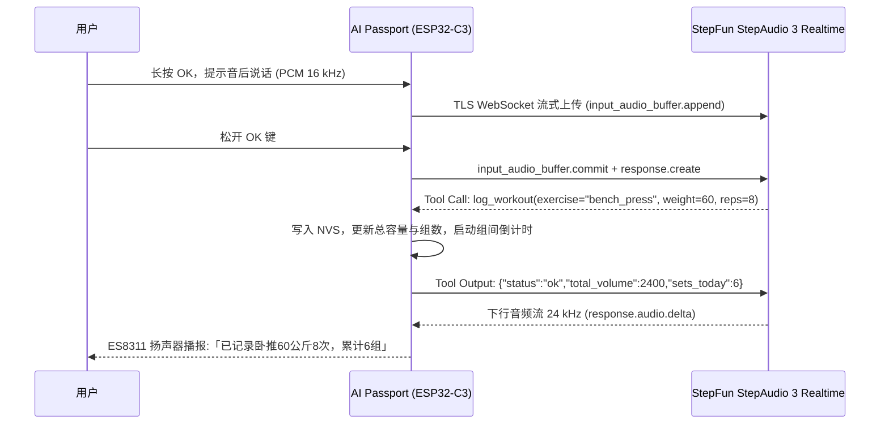

<p align="right">
  <strong>简体中文</strong> · <a href="README.md">English</a>
</p>

# Passport Health Buddy (随身健康助手)

挂在胸前或放在桌上的健康助手。办公时定时提醒活动与补水，健身房里说一句话记组并启动休息倒计时，在家进行 HIIT 间歇跟练与平板支撑。活动提醒按时间周期运行，不检测真实坐姿或起身。

搭载**阶跃星辰 StepAudio 3 实时双向语音大模型**，8 大端侧场景工具直接驱动硬件，纯本地状态机与 Flash 断电记忆，小巧屏幕告别手机依赖。

硬件基于 **FoloToy AI Passport**（ESP32-C3、240 × 320 绚丽彩屏、物理三键、麦克风与扬声器、500 mAh 电池）。

---

## 硬件真机与屏幕界面实拍

每页使用同一套卡片结构：顶部一行页面标题、静音标记和电量，下方分隔线；主体一个大读数、至多两行辅助信息和一个状态条。卡片下方是语音状态和单行主动作。居家页只显示居中的计时数字和一行提示，不轮播历史。完整按键说明在 `?` 帮助页。


---

## 快速上手：怎么用

### 1. 物理按键与手势

实体按键从上到下为 **UP 上键 → DOWN 下键 → OK 确认键**。所有模式使用相同手势：

| 按键 | 短按（松手执行） | 长按（约 0.5 秒） |
| --- | --- | --- |
| UP | 音量增加 10 个百分点 | 上一页 |
| DOWN | 音量减少 10 个百分点，最低静音 | 下一页 |
| OK | 执行当前页面主动作 | 提示音后说话，松手发送 |

长按每次只触发一次，松手不补短按；不使用双击或组合键。短按 OK 在办公页记水 250 ml，在健身页开始或结束 90 秒休息，在居家页开始、取消准备或结束平板计时；有间歇计划时结束跟练。

页面按「办公 → 健身 → 居家 → ?」循环；翻到 `?` 即显示帮助，短按确认返回原业务页。无需额外手势，不中断训练。

音量同时影响模型语音和提示音，停止调整约一秒后保存，静音不会关闭麦克风。切页不停止计时；语音记水、记组不抢走当前页面。活动提醒自行收起，不要求确认起身；实体按键没有撤销操作。

准备和开始沿用旧版 1000 / 2000 Hz 发令音，幅度约降低 3.5 dB；其他声音采用柔和的合成音，包括整分钟上行琶音。详见[音效与播放规则](docs/health-companion.zh_CN.md#音效与播放规则)。

调试语音使用[单轮 trace](docs/health-companion.zh_CN.md#5-每句话的-trace-与-prompt-调试)：关联识别文本、模型响应、工具执行与保存结果，并附 prompt／工具配置指纹。`python tools/voice-trace.py capture --help` 查看本地串口采集用法。

---

### 2. 语音大模型指令大全 (充分释放 StepAudio 3 能力)

不用生硬套话，长按 OK，听到提示音后像跟教练聊天一样说话，松手提交。等待当前回复结束后再发下一句。

#### ① 健身房智能记组 (支持 23 种动作、多组、单位自动换算与防错)
- **直接记组**：「卧推 60 公斤 8 个」、「深蹲 100 公斤 5 次做 3 组」、「坐姿划船 45 公斤 12 次」、「引体向上自重 10 个」。
- **杠铃每边重量换算**：「杠铃推举每边 20 公斤做了 8 个」➔ *大模型自动计算 `20×2 + 20(杠铃杆) = 60 kg`*。
- **磅转公斤自动换算**：「哑铃卧推 50 磅 10 次」➔ *大模型自动折算约 `22.5 kg`*。
- **器械与自由重量兜底**：「固定器械推胸 50 公斤 10 个」➔ *自动归入 machine 分类并记录英文名*。
- **即时纠错**：「刚才说错了，是 65 公斤」➔ *调用 `replace_last` 自动替换上一组*。
- **语音撤销**：「撤销上一条」或「取消刚才记录」；没有实体撤销键。
- **历史成绩对比**：如果本次重量超过历史记录，教练播报时还会简短夸你一句！

#### ② 场景切换与随身控制
- **模式切换**：「切换到健身房模式」、「去办公了」、「我要居家训练」。
- **计时与休息**：「组间休息两分钟」、「帮我倒计时 90 秒」、「计时一分半」。

#### ③ 喝水智能换算
- **日常口语计量**：「喝了一大杯水」(400ml)、「喝了半瓶水」(250ml)、「喝了一整瓶」(500ml)、「喝了一小口」(50ml)。
- **数字精确计量**：「记录喝水 300 毫升」。

#### ④ 居家跟练与日常查询
- **间歇跟练 (HIIT)**：「开始间歇训练，运动 30 秒休息 15 秒做 6 轮」。
- **推迟久坐提醒**：「十分钟后再提醒我」、「推迟 15 分钟」。
- **今日数据回顾**：「今天一共喝了多少水？」、「今天练了多少组了？」。

---

## 三大场景工作流

- **办公**：每 45 分钟提醒活动、每 60 分钟提醒补水；提醒只响一次并自行收起。喝水后短按 OK 或语音记录，也可语音推迟提醒。设备不判断是否已经起身。
- **健身**：长按 OK 报动作、重量、次数和组数，记录成功后开始休息。短按 OK 可提前结束休息；最后三秒用准备音，结束用开始音。
- **居家**：短按 OK 启动平板的四拍准备，语音可启动间歇计划。短按上下只调音量，长按上下翻页，均不结束训练；短按 OK 才取消或结束当前训练。

---

## 技术方案与端侧大模型架构



### 极简内存与端侧硬核调优
- **0 PSRAM 实时语音跑通**：ESP32-C3 仅约 400 KB 片上 SRAM。通过在链接期拦截 TLS 握手配置，开启 **RFC 6066 Max Fragment Length (4096 字节)**，将入站记录牢牢压制在 4KB，彻底解决 mbedTLS 申请 16KB 连续内存导致的 `-0x7F00` 内存溢出。
- **流式低延迟音频处理**：上行 16 kHz 麦克风音频以 80ms 为块 base64 流式上送；下行 24 kHz 音频在端侧由自研轻量重采样算法实时压至 16 kHz 播放，无需在 RAM 中保留整段音频。
- **纯本地断网兜底**：即使无 Wi-Fi 网络，本地三键切换模式、久坐/喝水计时、组间休息倒计时、平板支撑秒表及历史成绩完全可用。
- **隐私保护**：录音不落盘，日志不输出密码或 API Key。配网页凭据存于 NVS；可选的未跟踪 `sdkconfig.local` 会将凭据编入固件，含这些配置的镜像不能公开发布。未启用 NVS 加密时不宣称其为加密存储。

---

## 编译与烧录

### 环境要求
- ESP-IDF **5.5.3**

```bash
# 1. 激活 ESP-IDF 环境
source ~/esp/esp-idf-v5.5.3/export.sh

# 2. 运行完整工程验证 (仓库检查 + 单元测试 + 固件构建)
./tools/validate.sh

# 3. 烧录应用固件至真机 (注意：仅烧录 0x10000 Factory 分区，严禁 erase-flash)
python -m esptool --chip esp32c3 -p /dev/cu.usbmodem1201 -b 460800 \
    --before default_reset --after hard_reset write_flash \
    --flash_mode dio --flash_size 8MB --flash_freq 80m \
    0x10000 build/verified/application.bin
```

---

## 文档索引

- [随身健康助手全景设计文档](docs/health-companion.zh_CN.md)：三大模式详尽设计、8 大 Tools Schema、状态机与硬件边界
- [开发实施与验收计划](docs/plan.zh_CN.md)：内存实测、状态转移矩阵与排期
- [硬件规格说明书](docs/hardware-design/specifications.zh_CN.md)：引脚定义与外设规格
- [平板支撑计时器规范](docs/plank-trainer.md)：提示音频率、计时状态机

---

## 致谢与开源协议

- [FoloToy/ai-passport](https://github.com/FoloToy/ai-passport)：优秀轻巧的开源硬件与 BSP 框架（MIT）。
- [kunlun322/Qoder-Passport](https://github.com/kunlun322/Qoder-Passport)：配网、Wi-Fi 及 TLS 内存调优参考（MIT）。
- 本项目为 2026 阶跃星辰（StepFun）Hackathon 参赛作品。
