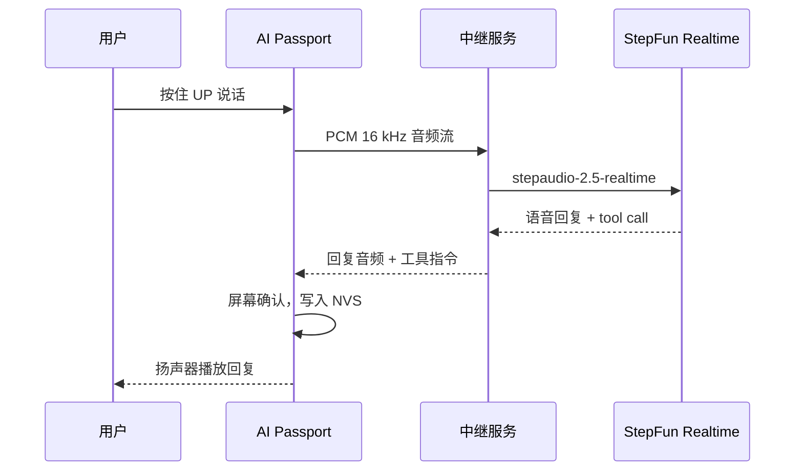

<p align="right">
  <strong>简体中文</strong> · <a href="README.md">English</a>
</p>

# Passport Health Buddy

挂在身上的常驻健康助手。办公时提醒起身和喝水，健身房里说一句话记一组、自动计组间休息，在家带你做平板支撑和间歇跟练。按住按键说话，阶跃星辰 Step 实时语音模型听懂并直接执行。

硬件是 FoloToy AI Passport：ESP32-C3、240 × 320 彩屏、三键、麦克风和扬声器、NFC、500 mAh 电池。

## 三种模式

| 模式 | 你做什么 | 设备做什么 |
| --- | --- | --- |
| 常驻 | 正常上班 | 每 45 分钟提醒起身，定时提醒喝水；说「喝了半瓶」自动记毫升数 |
| 健身房 | 按住 UP 说「卧推 60 公斤 8 个」 | 屏幕确认后记一组，自动开始 90 秒组间休息倒计时 |
| 居家 | 选平板支撑或间歇计划 | 发车提示音 + 屏幕倒计时带节奏，记录写入 Flash，断电不丢 |

晚上由 `step-5-preview` 根据当天记录生成日报，屏幕显示并朗读。

## Step 模型怎么用



- 实时语音：`wss://api.stepfun.com/v1/realtime`，模型 `stepaudio-2.5-realtime`，server VAD。
- 工具调用：`log_water`、`log_set`、`start_rest_timer`、`start_interval_plan`、`snooze_reminder`、`query_today`。模型负责听和说，状态和记录由设备持有。
- 日报：`step-5-preview`。
- API Key 只放在中继服务端，不进固件和仓库。

完整设计见[随身健康助手](docs/health-companion.zh_CN.md)。

## 代码结构

```text
main/                  应用：模式、计时、提醒、语音交互、界面
components/bsp/        板级驱动：屏幕、按键、音频、电池
tests/                 host 测试：计时状态机、存储、布局
tools/validate.sh      仓库检查 + host 测试 + 固件构建
docs/                  产品文档、硬件资料、开发指南
```

## 构建

需要 ESP-IDF 5.5.3。

```bash
./tools/validate.sh --static    # 仓库检查 + host 测试
./tools/validate.sh --firmware  # 固件构建 + 合并镜像校验
```

烧录前先看[固件布局](docs/development/engineering/firmware-layout.zh_CN.md)：合并镜像从 `0x0` 写入会覆盖 NVS。

## 文档

- [随身健康助手](docs/health-companion.zh_CN.md)：产品形态、语音链路、硬件边界
- [平板支撑自由计时器](docs/plank-trainer.md)：按键、提示音、记录语义
- [硬件规格](docs/hardware-design/specifications.zh_CN.md)
- [开发者文档索引](docs/README.zh_CN.md)：基于上游 AI Passport 的开发规范与 BSP 说明

## 致谢

基于 [FoloToy/ai-passport](https://github.com/FoloToy/ai-passport) 的 BSP 与开发框架。2026 阶跃 Hackathon 参赛作品。
