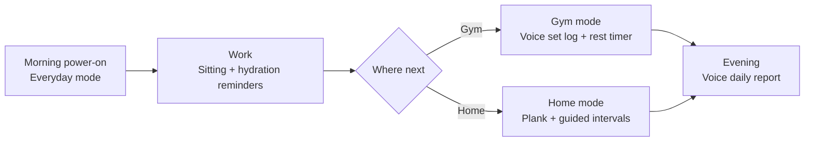
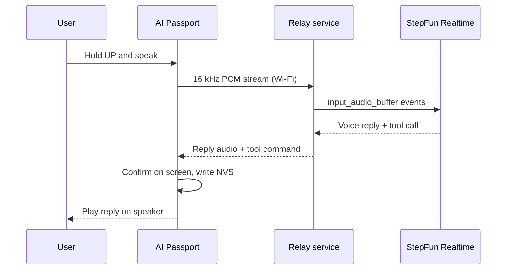

  <a href="health-companion.zh_CN.md">简体中文</a> · <strong>English</strong>

# Wearable Health Companion: Product Shape and Design

AI Passport stays on all day, clipped on or sitting on the desk. At work it handles sitting and hydration reminders; at the gym it logs sets and rest; at home it leads workouts. Hold a button and speak: a StepFun Step realtime voice model understands, answers, and changes device state directly.

## A day with the device

The user switches modes; the device does not detect location. See "Hardware limits" below.

## Everyday mode: sitting and hydration

The default mode. The screen shows today's cups of water, time since last stand-up, and the next reminder.

- Sitting: a reminder every 45 minutes by default, one tone plus a screen card saying "walk for two minutes". OK confirms you stood up and resets the timer; DOWN snoozes 10 minutes. The device has no motion sensor, so standing up relies on user confirmation.
- Hydration: reminders at a fixed interval; OK logs one cup. You can also say "I just drank half a bottle" and the model converts it to millilitres.
- Eyes: optional 20-20-20 reminder, every 20 minutes look at something far away for 20 seconds.
- Quiet hours: no reminders during lunch breaks, meetings, or at night.
- Each reminder fires once. Missed reminders leave a mark on screen and appear in the evening report.

## Gym mode: say it, log the set

At the gym your hands hold equipment or wear gloves. Pressing one key and speaking is faster than tapping a spreadsheet on a phone.

- Log a set: hold UP and say "bench press 60 kg, 8 reps". The model emits a function call with a structured record `{exercise, weight, reps}`, the screen shows a confirmation card, OK saves and DOWN discards.
- Rest timer: saving starts a rest countdown, 90 seconds by default, with a cue 10 seconds before the end. You can also say "rest two minutes".
- Queries: "what did I squat last time", "how many sets today"; the model reads local records and answers by voice.
- Offline fallback: without a network the rest timer and manual logging still work; voice logs queue and are parsed once the device is online.

## Home mode: plank and guided intervals

- Plank: start freely and stop any time; a four-beat start cue begins timing, with rhythm cues every 10 seconds. The latest 20 records persist in NVS across power loss. See [Plank Free Timer](plank-trainer.md) (Chinese).
- Interval workouts: pick a plan such as "30 s work / 15 s rest × 8 rounds". Tones and the on-screen countdown keep the pace without watching a phone.
- Voice coach: during a workout hold the key and ask "how many rounds left" or "make it easier", and the model adjusts the current plan. The coach handles pace and plan only; it does not judge form or give medical advice.

## Voice: push to talk, Step realtime voice answers

Interaction is push-to-talk: hold UP to speak, release to finish. The ESP32-C3 has no PSRAM; an always-on wake word would hold CPU and memory and drain the battery. Push-to-talk saves power and avoids false wakes.

The model is the StepFun open platform [Realtime API](https://platform.stepfun.com/docs/zh/api-reference/realtime/chat), WebSocket endpoint `wss://api.stepfun.com/v1/realtime`, model `stepaudio-2.5-realtime`:

- `pcm16` audio in and out.
- `session.update` sets the health-companion persona in `instructions` and the voice.
- Server VAD detects the end of speech.
- `tools` function calling lets the model trigger device actions directly.

Device-side tools:

| Tool | Purpose |
| --- | --- |
| `log_water(ml)` | Log water intake |
| `log_set(exercise, weight_kg, reps)` | Log one strength set |
| `start_rest_timer(seconds)` | Start a rest countdown |
| `start_interval_plan(work_s, rest_s, rounds)` | Start a home interval plan |
| `snooze_reminder(kind, minutes)` | Snooze a sitting or hydration reminder |
| `query_today(metric)` | Query today's water, stand-ups, and training |

The model understands and speaks; state and records stay in the device state machine and NVS. Tool calls returned by the model are confirmed on screen before they are stored.

Daily reports and weekly reviews come from `step-5-preview`: input is the day's structured records, output is a short summary shown on screen and read aloud.

### Data path

The device does not connect to StepFun directly; a relay service sits in between:

- The API key stays on the server, never in firmware or the repository.
- The device records and plays 16 kHz only; the relay converts sample rates to and from the model.
- Free heap on the C3 after startup is about 200 KB, so TLS plus audio buffers is tight; the relay also handles reconnects and session logging.
- The relay runs on a phone or laptop and does not depend on cloud deployment.

## Hardware limits

Based on the [product specification](hardware-design/specifications.md):

| Hardware | Use | Limit |
| --- | --- | --- |
| 240 × 320 color screen | Timers, reminders, confirmation cards | One primary item per screen |
| UP / DOWN / OK keys | Mode switching, confirmation, push-to-talk | No touch |
| Microphone + speaker (ES8311) | Voice input, replies, cues | Speak close to the device in noisy places |
| Wi-Fi, BLE 5 | Relay connection, phone provisioning | Use a phone hotspot where the gym has no Wi-Fi |
| NFC (passive NTAG213) | Phone tap opens the daily report | The device cannot read external NFC tags |
| 500 mAh battery | All-day use | Voice and Wi-Fi connect on demand to save power |

There is no accelerometer or heart-rate sensor, so no automatic sitting detection, step counting, heart rate, or motion recognition; those can come later from a BLE band or the phone.

## Health and privacy

- Reminders and logs only; no diagnosis, medical, or rehabilitation advice.
- Water and training records stay in device NVS by default; only the current utterance and the needed daily summary go to the model.
- Raw recordings are not stored.
- Logs and demo material contain no API keys, device QR codes, or personal data.

## Next steps

- BLE band data for steps and heart rate.
- NFC tap to view weekly reports and trends on the phone.
- Reminder intervals that adapt to personal habits.
