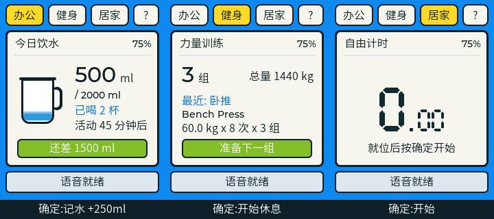
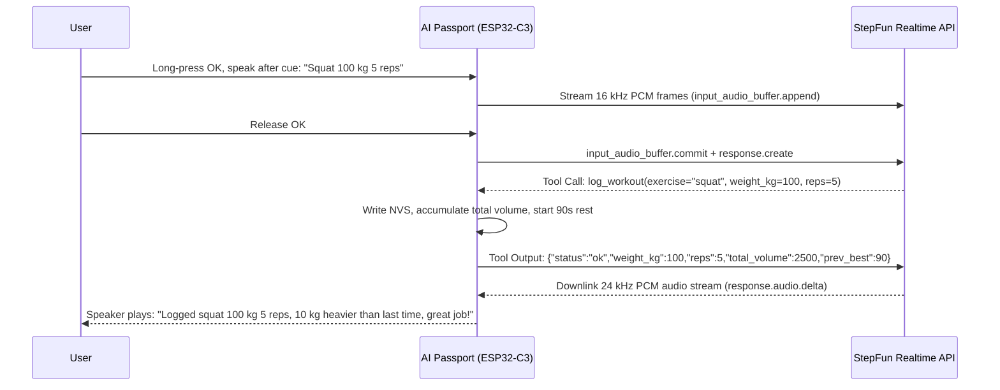

<p align="right">
  <a href="health-companion.zh_CN.md">简体中文</a> · <strong>English</strong>
</p>

# Wearable Health Companion: Product Design & User Guide

AI Passport is worn on your chest or placed on your desk: it schedules activity and hydration reminders at work, logs gym sets and rest periods by voice, and runs intervals and planks at home. It does not detect posture, actual sedentary duration, or standing up.

Powered by the **StepFun StepAudio 3 Realtime Voice Model**, 8 on-device scenario tools directly drive hardware states. Featuring a pure local state machine with Flash non-volatile memory, it eliminates smartphone dependency on an ultra-compact screen.

---

## 1. Screen & UI Layout (Simulator Preview)

Built on a 240 × 320 LCD color display, the interface uses three tiers:
1. **Top navigation**: Office, Gym, Home and `?`, reached with long UP/DOWN. `?` is button help; short OK returns to the previous business page. These are not touch targets.
2. **Main card**: All modes share a 224 × 200 light rounded card. A header row holds the page title (Today's water / Strength / Free timer / Help), the mute marker and battery, followed by a divider. The body has one large reading, at most two supporting lines and a status pill, without grass, characters or cast-shadow decorations.
3. **Status and primary action**: A 32 px voice bar and 28 px single-line footer replace permanent three-line help. Mute stays visible after the temporary volume overlay disappears.




### Visual Highlights
- **Mug and remaining amount**: The mug fills toward the goal; the reading shows `ml / goal`, and the status pill states how much is left.
- **High-contrast Typography**: In the gym, total volume and rest timers feature prominent numerals readable at a glance from exercise equipment.
- **Centered stopwatch**: Home shows only the centered seven-segment reading, minutes above it, and one hint line. Records are still kept in NVS but are not shown on the device.

---

## 2. How to Use: Operational Guide

### 1. Physical Three-Button Gestures

Physical order from top to bottom is **UP → DOWN → OK**:

| Button | Short press | Long press (about 0.5 seconds) |
| --- | --- | --- |
| UP | Raise volume by 10 percentage points | Previous page, wrapping |
| DOWN | Lower volume by 10 percentage points, down to mute | Next page, wrapping |
| OK | Current page's primary action | Speak after the cue, release to send |

Shorts execute on release; a long gesture triggers once and never also executes a short. No double-clicks or chords. Volume and speech work on every page. Mute leaves the microphone enabled and recording/timer state visible. Wait until the current reply ends before starting another utterance.

| Page state | Short OK |
| --- | --- |
| Office | Log 250 ml; two consecutive taps log 500 ml |
| Gym, idle | Start 90-second rest |
| Gym, resting | End rest early |
| Home, plank ready/result | Start four-second preparation |
| Home, preparing | Cancel preparation |
| Home, timing | End and request storage |
| Home, interval plan | End the current plan |
| Help | Return to the preceding business page without affecting timers |

No physical undo or standing acknowledgement. Activity reminders run every 45 minutes and hydration reminders every 60 minutes; Office notices dismiss after three seconds. Speech can snooze them. Other modes do not sound office reminders. Voice water/set logs update records without paging; explicit mode requests and interval starts may switch pages.

The plank ready/result page shows only the current reading and save status; the latest 20 durations are kept in NVS without an on-device history screen. A visible save status is not proof of a successful Flash write. Volume is saved separately in NVS about one second after adjustments stop; allow this time before power-off. Failures are shown; restart uses the last successfully saved volume.

### Sound and playback rules

| Event | Cue |
| --- | --- |
| Preparation | Original 1000 Hz, 120 ms square; four plank beats, last three rest seconds |
| Start / rest complete | Original 2000 Hz, 350 ms square |
| 10 seconds / half-minute / minute | Light tick / single bell / rising three-note arpeggio, not a triple error-like beep |
| Stop / enter rest / all complete | Resolving descent / gentle descent / four-note ascent |
| Activity and hydration reminders | One gentle two-note cue, no acknowledgement |
| Record / volume / listening / sent / failure | Distinct brief feedback; failure never uses a success cue |

Preparation and start retain their waveforms with peak amplitude reduced from 6000 to 4015, about -3.49 dB. Other cues match the selected preview using fixed-point sine tables, harmonics and decay envelopes at 16 kHz, 16-bit mono. Frequent ticks stay quieter than milestones; cues are not all peak-normalized. Perceived loudness on the physical speaker still needs acceptance.

A single task writes both model speech and local cues to the speaker, without mixing. The listening cue and buffered tail finish before microphone upload begins. Recording and replies take precedence; expired cues are skipped instead of replayed as a delayed burst. Mute affects speech and cues while visual feedback remains.

---

## 3. How to Use: StepAudio 3 Voice Command Reference

Powered by StepFun's **StepAudio 3 Realtime** bidirectional voice model, natural conversation triggers 8 on-device tools without rigid phrase templates:

### 1. Gym Strength Workout Logging (`log_workout`)
- **Direct spoken sets**:
  - "Bench press 60 kg 8 reps"
  - "Squat 100 kg 5 reps for 3 sets"
  - "Pull-ups bodyweight 12 reps" (bodyweight sets automatically map to `weight_kg=0`)
  - "Lateral raises 10 kg 15 reps"
- **Auto unit conversion & barbell math**:
  - "Overhead press 20 kg per side for 8 reps" ➔ *Model computes `20×2 + 20(bar) = 60 kg`*.
  - "Dumbbell press 50 lbs 10 reps" ➔ *Model converts pounds to kilograms: `50 × 0.45 = 22.5 kg`*.
- **23 Whitelisted Exercises & Category Fallbacks**:
  - 23 gold-standard movement enums: `bench_press`, `incline_press`, `squat`, `deadlift`, `romanian_deadlift`, `overhead_press`, `barbell_row`, `dumbbell_row`, `curl`, `lateral_raise`, `hip_thrust`, `lunge`, `lat_pulldown`, `seated_row`, `leg_press`, `leg_extension`, `leg_curl`, `chest_fly`, `triceps_pushdown`, `pull_up`, `push_up`, `dip`, `crunch`.
  - Exercises outside the list are designated as `other` with appropriate category (`machine`, `cable`, `free_weight`) and English name sanitization.
- **Immediate correction & undo**:
  - "Correction, that was 65 kg" ➔ *Triggers `replace_last=true` to replace the last set*.
  - "Undo last entry" ➔ *Calls `undo_last` to revert*.
- **Coach encouragement**:
  - When a set beats your recorded personal best, the coach adds a concise word of praise!

### 2. Mode & Timer Control (`set_mode` & `start_timer`)
- **Voice mode switching**: "Switch to gym mode", "Back to work", "Start home workout".
- **Rest & timers**: "Rest for two minutes", "Start 90 seconds rest timer", "Timer for one and a half minutes".

### 3. Smart Hydration Logging (`log_water`)
- **Natural speech conversions**:
  - "Drank a large cup of water" ➔ Auto logged as 400 ml.
  - "Drank a glass of water" / "Drank half a bottle" ➔ Auto logged as 250 ml.
  - "Finished an entire bottle" ➔ Auto logged as 500 ml.
  - "Took a small sip" ➔ Auto logged as 50 ml.
- **Exact values**: "Log 350 ml of water".

### 4. Home Workouts & Daily Queries (`start_interval_plan` & `query_today`)
- **HIIT interval training**: "Start interval training, 40 seconds work 20 seconds rest for 5 rounds".
- **Snooze reminders**: "Remind me in 10 minutes", "Snooze for 20 minutes".
- **Daily queries**: "How much water did I drink today?", "How many bench press sets did I do?".

---

## 4. Daily Workflows

- **Office**: No standing check-in. Reminders dismiss automatically; short OK or speech logs water.
- **Gym**: Long-press OK to report exercise, load and reps. The model receives the storage result before its brief reply. Logging starts rest, with preparation cues in the final three seconds.
- **Home**: Short OK starts a plank or ends the current exercise; speech starts an interval plan. Timers continue on other pages and remain visible when returning Home.

---

## 5. StepAudio 3 On-Device Tools (8 Schemas)

The device registers 8 lightweight tools with StepFun Realtime:

| Tool Name | Purpose | Key Parameters |
| :--- | :--- | :--- |
| `log_workout` | Log strength exercise, weight, reps, sets | `exercise`, `weight_kg`, `reps`, `sets`, `replace_last`, `category`, `name_en` |
| `log_water` | Log hydration volume | `ml` (integer) |
| `start_timer` | Start rest or general timer | `seconds` (integer) |
| `start_interval_plan` | Start HIIT interval workout | `work_s`, `rest_s`, `rounds` |
| `set_mode` | Switch device screen mode | `mode` ("office" / "gym" / "home") |
| `undo_last` | Undo last logged set or water | none |
| `snooze_reminder` | Snooze sedentary or water reminder | `minutes` (integer) |
| `query_today` | Query today's accumulated metrics | `metric` ("water" / "workout" / "all") |

### Bidirectional Sequence & Zero-Hallucination Assurance



---

## 6. Technical Architecture & Engineering Optimization

### 1. Zero-PSRAM Optimization on ESP32-C3
With only ~400 KB internal SRAM and no external PSRAM:
- **RFC 6066 Max Fragment Length (MFL)**: Link-time interception of `mbedtls_ssl_config_defaults()` negotiates a 4096-byte fragment length, restricting inbound TLS records to ≤4KB and eliminating `-0x7F00` allocation failures from default 16KB records.
- **Static Memory Footprint**: mbedTLS configured with fixed 8KB receive / 4KB send buffers with `CONFIG_MBEDTLS_DYNAMIC_BUFFER=n`; TCP receive window tightened to 8KB.
- **Streaming Downlink Audio**: 24 kHz downlink audio is converted to 16 kHz on-the-fly via fixed-point linear interpolation directly into the ES8311 I2S ringbuffer without buffering full audio responses.

### 2. State Machine Decoupling & Host Tests
- Core state machines (timers, unit conversions, interval workout models, and plank stopwatch) operate completely decoupled from ESP-IDF and LVGL dependencies, running host test suites in milliseconds via `gcc` in CI.
- Host validation covers gestures, timers, reminders, corrections and full-history persistence, saved mute, audio chunk continuity and actual LVGL rendering. Automated results are not hardware acceptance.

### 3. Hardware Specifications
- **Display**: ST7789v3 240 × 320 color LCD, SPI interface, LVGL 9.3 partial redraws.
- **Audio**: ES8311 codec, digital I2S, onboard omnidirectional microphone and miniature speaker.
- **Battery**: 500 mAh Li-Po. After network configuration the app maintains its realtime session; it does not promise low-power sleep or a measured runtime.
- **Wi-Fi**: 2.4 GHz (802.11 b/g/n); 5 GHz is not supported.

### 4. Privacy & Data Integrity
- Provisioned credentials reside in NVS. The optional untracked `sdkconfig.local` embeds local credentials into firmware. Logs must omit passwords/API keys, and credential-bearing firmware/debug bundles must not be published. Default NVS encryption is not claimed.
- Microphone upload is limited to the long-OK recording flow and stops after release; recordings are not saved locally.

### 5. Per-utterance traces and prompt debugging

The serial `voice_trace` tag emits single-line JSON. A random `run` and incrementing local `turn` identify startup and utterance, joined to server `session`, user `input`, `response`, `call` and client `event` IDs. `config` is an FNV-1a fingerprint of the complete `SESSION` configuration in `main/step_voice.c`, for comparing prompt/tool configuration versions, not a security hash. `session.config` also records the model. After changing a prompt, rebuild, obtain flash approval, and compare identical utterances across configuration fingerprints.

| Stage | Evidence |
| --- | --- |
| `turn.begin` / `mic.ready` / `input.commit` | Turn, microphone upload start, recording duration, successfully uploaded samples/chunks, submission result |
| `conversation.item.input_audio_transcription.completed` | User input ID and final recognized text |
| `response.created` / `response.audio_transcript.done` | Response ID and final spoken reply text |
| `response.function_call_arguments.done` / `tool.queue` / `tool.execute` | Tool name, call ID, arguments and queue outcome |
| `tool.result` / `tool.output.sent` | Business validation, NVS commit/failure, result transmission |
| `response.done` | Final status/failure reason, message and tool-call counts; done does not imply success |
| `playback.done` / `playback.failed` | Received, queued, dropped and successfully I2S-written samples, and last volume; not proof of audible output or sound pressure |

Defaults emit only correlation metadata, status and counts. For diagnosis, add `CONFIG_HEALTH_VOICE_TRACE_TEXT=y` to **untracked** `sdkconfig.local` to include recognition, replies and tool content. These logs may contain private workout data and must not be committed or published. The known API key is scrubbed from string values; audio base64, Authorization headers and the full session configuration are never logged. Disable the option and rebuild after diagnosis; deleting local logs alone does not disable it.

Capture with the activated ESP-IDF Python. The utility sends no reset command, refuses to overwrite an existing file, and closes the port after the bounded capture (60 seconds by default):

```bash
python tools/voice-trace.py capture --port /dev/cu.usbmodem1201 --seconds 60 --out build/traces/gym-before.jsonl
python tools/voice-trace.py summary build/traces/gym-before.jsonl
python tools/voice-trace.py summary build/traces/gym-before.jsonl --content
```

Only structured trace rows are retained, with file permissions `0600`; unrelated Wi-Fi/system serial text is excluded. Summary content is hidden unless `--content` is passed. ASR may arrive after a response or before commit acknowledgement; the report joins it by `run + input`, never by arrival order. Firmware retains four turns and bounded identifier maps; unresolved events use `turn=0`, and oversized content sets `truncated`. Audio deltas update counters without flooding serial logs.

For a missing record, inspect final recognition, then `response.done.output_tools` under `metrics`, then `tool.result` and storage outcome. A spoken answer without a tool call is not a successful record. For inaudible replies, inspect `volume=0` and playback counters. Protocol sources: [Realtime event reference](https://platform.stepfun.com/docs/zh/api-reference/realtime/chat) and [developer guide](https://platform.stepfun.com/docs/zh/guides/developer/realtime). This is not a platform-side historical trace-query API.


---

## 7. Build, Validation & Flashing

```bash
# 1. Run local repository validation and host tests
./tools/validate.sh --static

# 2. Compile and verify firmware binary (ESP-IDF 5.5.3)
source ~/esp/esp-idf-v5.5.3/export.sh
./tools/validate.sh --firmware

# 3. Flash application binary to Factory partition (Port /dev/cu.usbmodem1201)
python -m esptool --chip esp32c3 -p /dev/cu.usbmodem1201 -b 460800 \
    --before default_reset --after hard_reset write_flash \
    --flash_mode dio --flash_size 8MB --flash_freq 80m \
    0x10000 build/verified/application.bin
```
