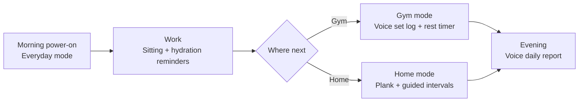
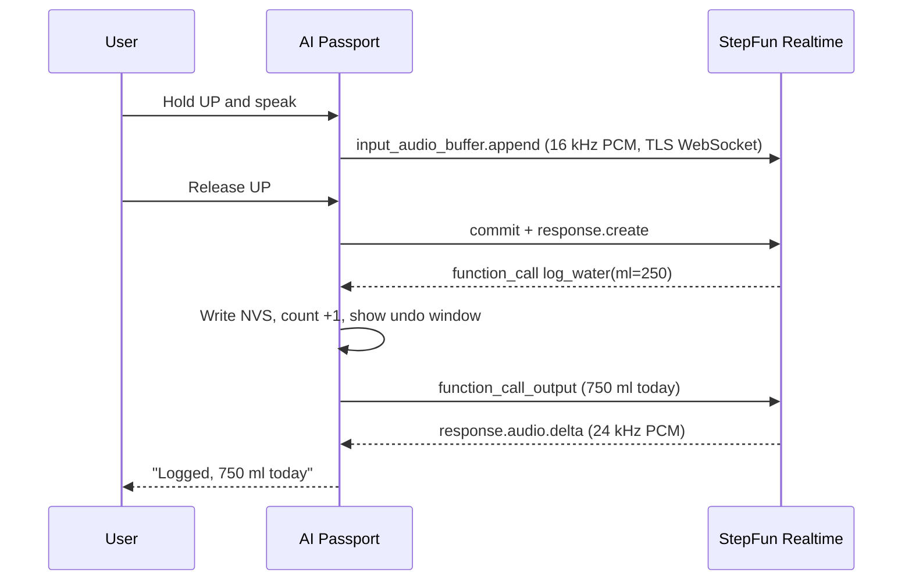

  <a href="health-companion.zh_CN.md">简体中文</a> · <strong>English</strong>

# Wearable Health Companion: Product Shape and Design

AI Passport stays on all day, clipped on or sitting on the desk. At work it handles sitting and hydration reminders; at the gym it logs sets and rest; at home it leads workouts. Hold a button and speak: the StepFun StepAudio 3 realtime voice model understands, answers, and changes device state directly.

## Innovations

- The model drives hardware: StepAudio 3 does more than chat; tool calls change device state (water count, rest countdown, training records). The device writes Flash first and returns the result, so the model speaks real device data.
- One-sentence gym logging: say "bench press 60 kg, 8 reps" with equipment in hand to create a structured record, no phone spreadsheet.
- Direct to cloud: the ESP32-C3 connects to the StepFun Realtime API over a TLS WebSocket, with no laptop or server relay. Any network works.
- Realtime voice without PSRAM: TLS record fragments, TCP window, and Wi-Fi buffers are tuned for the C3's 400 KB SRAM.
- Push-to-talk instead of a wake word, fitting a chip without PSRAM and a 500 mAh battery. Timers and manual logs keep working offline.

## Step model usage

| Model | Use | Interface |
| --- | --- | --- |
| `stepaudio-3-realtime-preview` | Speech understanding, voice replies, tool calls that drive device actions, evening voice report | Realtime API, `wss://api.stepfun.com/v1/realtime` |
| `step-audio-2` | Fallback with the same protocol; only the model name changes | Same |

## Technical design

- Firmware: ESP-IDF 5.5.3 with FreeRTOS tasks; LVGL draws the 240 × 320 UI; records are a versioned blob in NVS.
- State machines: one per mode (everyday, gym, home); timer, reminder, and record logic is independent of ESP-IDF and LVGL and covered by host tests.
- Provisioning: on first boot the device opens a hotspot; a phone opens `192.168.4.1` to enter Wi-Fi and the StepFun API key. The device verifies the key before storing it in NVS. No secret is compiled into firmware.
- Voice pipeline: 16 kHz PCM is uploaded in base64 chunks; 24 kHz downlink PCM is parsed as it streams, never buffering a whole message, and resampled to 16 kHz on device with pre-buffering and fades.
- Memory: static mbedTLS buffers with Max Fragment Length (4 KB out / 8 KB in), an 8 KB TCP window, and Wi-Fi IRAM optimisation off leave heap for audio and TLS.

Networking, provisioning, and the voice pipeline build on the open-source [Qoder-Passport](https://github.com/kunlun322/Qoder-Passport) (MIT); the protocol layer is rewritten for StepFun Realtime events and tool calls.

## A day with the device

The user switches modes; the device does not detect location. See "Hardware limits" below.

## Everyday mode: sitting and hydration

The default mode. The screen shows today's cups of water, time since last stand-up, and the next reminder.

- Sitting: a reminder every 45 minutes by default, one tone plus a screen card saying "walk for two minutes". OK confirms you stood up and resets the timer; DOWN snoozes 10 minutes. The device has no motion sensor, so standing up relies on user confirmation.
- Hydration: reminders at a fixed interval; OK logs one cup. You can also say "I just drank half a bottle" and the model converts it to millilitres.
- Eyes: optional 20-20-20 reminder, every 20 minutes look at something far away for 20 seconds.
- Quiet hours: no reminders during lunch breaks, meetings, or at night.
- Each reminder fires once. Missed reminders leave a mark on screen and appear in the evening report.

## Gym mode: say it, log the set

At the gym your hands hold equipment or wear gloves. Pressing one key and speaking is faster than tapping a spreadsheet on a phone.

- Log a set: hold UP and say "bench press 60 kg, 8 reps". The model emits a function call with a structured record `{exercise, weight, reps}`; the device saves it at once and shows "Logged · DOWN to undo" for 5 seconds.
- Rest timer: saving starts a rest countdown, 90 seconds by default, with a cue 10 seconds before the end. You can also say "rest two minutes".
- Queries: "what did I squat last time", "how many sets today"; the model reads local records and answers by voice.
- Offline fallback: without a network the rest timer and manual logging still work.

## Home mode: plank and guided intervals

- Plank: start freely and stop any time; a four-beat start cue begins timing, with rhythm cues every 10 seconds. The latest 20 records persist in NVS across power loss. See [Plank Free Timer](plank-trainer.md) (Chinese).
- Interval workouts: pick a plan such as "30 s work / 15 s rest × 8 rounds". Tones and the on-screen countdown keep the pace without watching a phone.
- Voice coach: during a workout hold the key and ask "how many rounds left" or "make it easier", and the model adjusts the current plan. The coach handles pace and plan only; it does not judge form or give medical advice.

## Voice: push to talk, StepAudio 3 answers

Interaction is push-to-talk: hold UP to speak, release to finish. The ESP32-C3 has no PSRAM; an always-on wake word would hold CPU and memory and drain the battery. Push-to-talk saves power and avoids false wakes.

The model is StepFun [StepAudio 3 Realtime](https://platform.stepfun.com/docs/zh/guides/models/stepaudio-3-realtime) over the [Realtime API](https://platform.stepfun.com/docs/zh/api-reference/realtime/chat):

- `session.update` sets the health-companion persona in `instructions`, the voice, and the device tools.
- While UP is held the device streams `input_audio_buffer.append`; on release it sends `input_audio_buffer.commit` + `response.create`. Server VAD stays off.
- On `response.function_call_arguments.done` the device runs the action and writes NVS; after `response.done` it returns `function_call_output` and requests the next response.
- `response.audio.delta` plays as it streams.

Device-side tools:

| Tool | Purpose |
| --- | --- |
| `log_water(ml)` | Log water intake |
| `log_set(exercise, weight_kg, reps)` | Log one strength set |
| `start_rest_timer(seconds)` | Start a rest countdown |
| `start_interval_plan(work_s, rest_s, rounds)` | Start a home interval plan |
| `snooze_reminder(kind, minutes)` | Snooze a sitting or hydration reminder |
| `query_today(metric)` | Query today's water, stand-ups, and training |

The model understands and speaks; state and records stay in the device state machine and NVS. Tool calls run immediately with a 5-second on-screen undo window; the model waits for the device result before speaking, so what it says matches what was stored.

The evening report uses the same Realtime session: the device sends the day's structured records as a text message and the model speaks a short summary while the screen shows it.

### Data path

## Hardware limits

Based on the [product specification](hardware-design/specifications.md):

| Hardware | Use | Limit |
| --- | --- | --- |
| 240 × 320 color screen | Timers, reminders, undo cards | One primary item per screen |
| UP / DOWN / OK keys | Mode switching, confirmation, push-to-talk | No touch |
| Microphone + speaker (ES8311) | Voice input, replies, cues | Speak close to the device in noisy places |
| Wi-Fi 2.4 GHz | Direct StepFun connection, provisioning hotspot | No 5 GHz; use a phone hotspot where the gym has no Wi-Fi |
| NFC (passive NTAG213) | Phone tap opens the daily report | The device cannot read external NFC tags |
| 500 mAh battery | All-day use | Voice sessions open on demand and close afterwards to save power |

There is no accelerometer or heart-rate sensor, so no automatic sitting detection, step counting, heart rate, or motion recognition; those can come later from a BLE band or the phone.

## Health and privacy

- Reminders and logs only; no diagnosis, medical, or rehabilitation advice.
- Water and training records stay in device NVS; only the current utterance and the needed daily summary go to the model.
- Raw recordings are not stored.
- The API key lives only in device NVS, never in firmware, the repository, or logs.

## Next steps

- BLE band data for steps and heart rate.
- NFC tap to view weekly reports and trends on the phone.
- Reminder intervals that adapt to personal habits.
