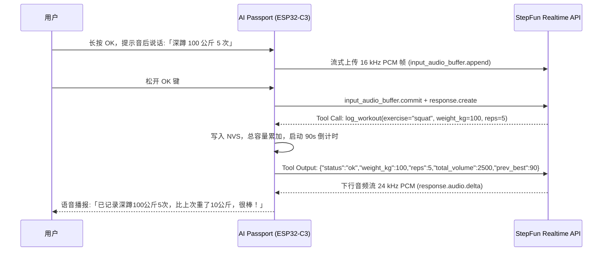

<p align="right">
  <strong>简体中文</strong> · <a href="health-companion.md">English</a>
</p>

# 随身健康助手：产品形态与用户指南

AI Passport 挂在胸前或放在桌上：办公时按周期提醒活动与喝水，健身时语音记组并计时休息，居家时进行间歇跟练与平板支撑。设备不检测坐姿、真实久坐时长或是否起身。

搭载**阶跃星辰 StepAudio 3 实时双向语音大模型**，8 大端侧场景工具直接驱动硬件，纯本地状态机与 Flash 断电记忆，打造无屏幕焦虑、无需掏手机的随身健康伙伴。

---

## 一、屏幕界面一览 (UI 布局与模拟器视图)

基于 240 × 320 LCD 彩屏，界面分为三层：
1. **顶部导航**：「办公」「健身」「居家」「?」，长按上下翻页。`?` 是按键帮助页，短按确认返回进入帮助前的业务页；这些标签不是触屏按钮。
2. **中部主卡片**：三种模式统一使用 224 × 200 的浅色圆角卡片。卡片顶部一行放页面标题（今日饮水／力量训练／自由计时／按键帮助）、静音标记和电量，下接分隔线；主体只有一个大读数、至多两行辅助信息和一个状态条，不绘制草地、人物或投影装饰。
3. **底部状态与主动作**：32 px 语音状态条加 28 px 单行操作区，不常驻三行帮助。静音标记持续显示，音量浮层自行收起。


### 细节设计亮点
- **水杯与剩余量**：水位随目标进度上升，读数显示「已喝 / 目标」，状态条直接写还差多少。
- **高对比大字号**：健身房场景中，总容量与组间倒计时采用超大字号，器械旁一眼即见。
- **居中计时**：居家页只保留居中的七段数字、上方分钟和一行提示；记录仍写入 NVS，但设备上不显示历史。

---

## 二、怎么用：操作全景手册

### 1. 物理三键手势

实体顺序从上到下为 **UP → DOWN → OK**：

| 按键 | 短按 | 长按（约 0.5 秒） |
| --- | --- | --- |
| UP | 音量加 10 个百分点 | 上一页，循环翻页 |
| DOWN | 音量减 10 个百分点，最低静音 | 下一页，循环翻页 |
| OK | 当前页面主动作 | 提示音后说话，松手发送 |

短按在松手时执行；长按只触发一次，松手不补短按，不使用双击或组合键。所有页面都能调音量和使用语音；静音不会关闭麦克风，屏幕仍显示录音和计时状态。新一句语音须等待当前回复结束。

| 页面状态 | 短按 OK |
| --- | --- |
| 办公 | 记水 250 ml，连续两次就是 500 ml |
| 健身，未休息 | 开始 90 秒休息 |
| 健身，休息中 | 提前结束休息 |
| 居家，平板等待或结果 | 开始四秒准备 |
| 居家，准备中 | 取消准备 |
| 居家，计时中 | 结束并请求保存 |
| 居家，间歇跟练中 | 结束当前计划 |
| 帮助 | 返回进入帮助前的业务页，计时不受影响 |

实体键不提供撤销，也没有“确认已起身”。活动提醒每 45 分钟触发，补水提醒每 60 分钟触发，在办公页显示三秒后自行收起；语音可推迟提醒。其他模式不发出办公提醒。语音记水和记组只改变记录，不跳页；明确的语音切模式和启动跟练才切页。

平板等待与结果页只显示当前读数和保存状态；最近 20 次时长保存在 NVS，设备上不提供历史页。看到“已保存”不代表一定已经写入 Flash。音量停止调整约一秒后单独写入 NVS，关机前应留出保存时间；保存失败会提示，重启使用上次成功保存的音量。

### 音效与播放规则

| 事件 | 声音 |
| --- | --- |
| 准备倒数 | 原 1000 Hz、120 ms 方波；平板四拍、休息最后三秒 |
| 开始／休息结束 | 原 2000 Hz、350 ms 方波 |
| 10 秒／半分钟／整分钟 | 轻嗒／单钟／上行三音琶音，不再用三连嘟表示整分钟 |
| 结束／进入休息／全部完成 | 收尾下行／柔和下行／四音上行 |
| 活动与补水提醒 | 一次轻柔双音，不要求回应 |
| 已记录／音量／开始听／已发送／失败 | 各自的短反馈；失败不用成功音 |

准备和开始只降低幅度，峰值从 6000 调为 4015，约 -3.49 dB。其余沿用试听定稿音色，以定点正弦表、泛音与衰减包络生成 16 kHz、16-bit 单声道 PCM。保留节拍轻、里程碑较明显的层次，不把所有声音归一到同一峰值；真机喇叭的主观等响仍需验收。

模型回复和本地提示音由同一个任务写入扬声器，不叠播。录音前先播放开始听提示并排出缓冲尾音；录音、回复期间普通提示让路，超过时限的提示跳过，不在稍后补响一串。静音同时作用于语音与音效，屏幕反馈保留。

---

## 三、怎么用：StepAudio 3 语音大模型指令大全

搭载阶跃星辰 **StepAudio 3 Realtime** 实时双向语音大模型，用户无需使用固定口令，直接自然交流即可触发 8 大端侧工具：

### 1. 健身房力量训练记组 (`log_workout`)
- **常见动作自由报数**：
  - 「卧推 60 公斤 8 个」
  - 「深蹲 100 公斤 5 次做了 3 组」
  - 「引体向上自重 12 个」（自重动作自动识别 `weight_kg=0`）
  - 「哑铃侧平举 10 公斤 15 次」
- **智能单位折算与杠铃计算**：
  - 「杠铃推举每边 20 公斤 8 次」➔ *大模型自动计算每边×2加杆重：`20×2 + 20 = 60 kg`*。
  - 「哑铃卧推 50 磅 10 个」➔ *大模型自动将磅换算为公斤：`50 × 0.45 = 22.5 kg`*。
- **枚举白名单与器械兜底**：
  - 内置 23 种黄金动作枚举：`bench_press`, `incline_press`, `squat`, `deadlift`, `romanian_deadlift`, `overhead_press`, `barbell_row`, `dumbbell_row`, `curl`, `lateral_raise`, `hip_thrust`, `lunge`, `lat_pulldown`, `seated_row`, `leg_press`, `leg_extension`, `leg_curl`, `chest_fly`, `triceps_pushdown`, `pull_up`, `push_up`, `dip`, `crunch`。
  - 不在白名单的动作自动填充 `other`，并附带分类（`machine`/`cable`/`free_weight`）与英文名称（如 `leg_adduction`），杜绝中文缺字乱码。
- **即时纠正与撤销**：
  - 「刚才说错了，是 65 公斤」➔ *大模型触发 `replace_last=true` 覆盖上一组*。
  - 「撤销刚才记录」➔ *调用 `undo_last` 恢复数据*。
- **教练成就鼓励**：
  - 当次记录重量超过历史同动作记录时，模型会在语音简短播报中夸你一句！

### 2. 模式与倒计时控制 (`set_mode` & `start_timer`)
- **语音切换设备模式**：「切换到健身房模式」、「去办公了」、「我要居家训练」。
- **随身休息倒计时**：「休息两分钟」、「帮我倒计时 90 秒」、「计时一分半」。

### 3. 喝水智能计量 (`log_water`)
- **口语量词换算**：
  - 「喝了一大杯水」➔ 自动记为 400 ml。
  - 「喝了一杯水」/「喝了半瓶水」➔ 自动记为 250 ml。
  - 「喝了一整瓶水」➔ 自动记为 500 ml。
  - 「抿了一小口」➔ 自动记为 50 ml。
- **精确毫升**：「记录喝水 350 毫升」。

### 4. 居家跟练与日常查询 (`start_interval_plan` & `query_today`)
- **间歇训练跟练**：「开始间歇训练，运动 40 秒休息 20 秒做 5 轮」。
- **推迟久坐提醒**：「十分钟后再提醒我」、「推迟 20 分钟」。
- **今日数据查询**：「今天喝了多少水了？」、「今天练了多少组卧推？」。

---

## 四、三大生活场景深度玩法

- **办公**：不需要起身打卡。提醒自动收起，喝水时短按 OK 或语音记录。
- **健身**：长按 OK 报动作、重量和次数，保存结果回传模型后简短播报；记组后启动休息，最后三秒提示下一组准备。
- **居家**：短按 OK 开始平板或结束当前训练；语音启动间歇计划。切到其他模式后计时继续，回到居家仍能查看。

---

## 五、StepAudio 3 端侧工具协议 (8 大 Tools Schema)

设备向 StepFun Realtime 服务端声明了 8 个端侧轻量工具：

| 工具名称 | 作用 | 核心参数 |
| :--- | :--- | :--- |
| `log_workout` | 记录力量动作、重量、次数、组数 | `exercise`, `weight_kg`, `reps`, `sets`, `replace_last`, `category`, `name_en` |
| `log_water` | 记录饮水量 | `ml` (整数) |
| `start_timer` | 启动组间休息或通用倒计时 | `seconds` (秒数) |
| `start_interval_plan` | 启动间歇跟练计划 | `work_s`, `rest_s`, `rounds` |
| `set_mode` | 语音切换设备屏幕模式 | `mode` ("office" / "gym" / "home") |
| `undo_last` | 撤销刚才记录的动作或喝水 | 无参 |
| `snooze_reminder` | 推迟久坐或喝水提醒 | `minutes` (分钟数) |
| `query_today` | 查询当天累计健康数据 | `metric` ("water" / "workout" / "all") |

### 双向时序与零虚构保证



---

## 六、技术实现与工程调优 (Technical Highlights)

### 1. 0 PSRAM 芯片上的极致内存调优
ESP32-C3 无外部 PSRAM，片上仅约 400 KB SRAM。为了保证 Wi-Fi + TLS WebSocket + 实时双向音频能够稳定并发：
- **RFC 6066 Max Fragment Length (MFL)**：在链接期拦截 `mbedtls_ssl_config_defaults()`，强制向服务端协商 4096 字节最大分片，入站记录严格限制在 4KB，避免系统为 16.7KB 大包申请连续内存失败。
- **静态缓冲设计**：mbedTLS 采用 8KB 接收 / 4KB 发送缓冲，关闭 `CONFIG_MBEDTLS_DYNAMIC_BUFFER`；收紧 TCP 接收窗口至 8KB。
- **流式音频下行**：下行 24 kHz 音频在端侧由自研定点重采样算法直接压为 16 kHz 填入 ES8311 环形缓冲区，不堆积未解压音频。

### 2. 状态机解耦与 Host Tests 覆盖
- 核心状态机（久坐/喝水计时、动作换算、间歇训练模型、平板支撑秒表）完全独立于 ESP-IDF 与 LVGL 硬件依赖，可在开发机通过 `gcc` 毫秒级运行测试并接入 CI。
- 按键手势、计时、提醒、记录更正与满容量保存、静音持久化、音效分块连续性和实际 LVGL 渲染均有 host 验证；不将自动化结果描述为真机验收。

### 3. 硬件规格与边界约束
- **屏幕**：ST7789v3 240 × 320 彩屏，SPI 驱动，LVGL 9.3 局部刷新。
- **音频**：ES8311 音频编解码芯片，数字 I2S 接口，板载全向麦克风与微型扬声器。
- **电池**：500 mAh 锂电池。配置网络后维持实时语音会话；本应用未承诺低功耗休眠或续航时长。
- **网络**：支持 2.4 GHz Wi-Fi（802.11 b/g/n），不支持 5 GHz。

### 4. 隐私安全与数据保护
- 配网页凭据存于 NVS；可选的未跟踪 `sdkconfig.local` 会将本地凭据编入固件。日志不得输出密码和 API Key，含凭据的固件与调试产物不得公开发布；不宣称默认启用 NVS 加密。
- 仅在长按 OK 的录音流程中上传麦克风数据，松手后停止；录音不在本地落盘。

### 5. 每句话的 trace 与 prompt 调试

串口 `voice_trace` 输出单行 JSON，以随机 `run` 和本地递增 `turn` 区分启动与话轮，并关联服务端 `session`、用户 `input`、`response`、`call` 和客户端 `event` ID。`config` 是 `main/step_voice.c` 中完整 `SESSION` 配置的 FNV-1a 指纹，用于比较 prompt／工具配置版本，不是安全哈希。模型名称另在 `session.config` 中记录。修改 prompt 后应重新构建、确认烧录，再用相同话术比较不同 `config` 的结果。

| 阶段 | 可观察信息 |
| --- | --- |
| `turn.begin` / `mic.ready` / `input.commit` | 话轮、麦克风上传起点、录音时长、成功上传采样数及块数、提交结果 |
| `conversation.item.input_audio_transcription.completed` | 用户输入 ID 和最终识别文本 |
| `response.created` / `response.audio_transcript.done` | 模型响应 ID、最终回复文本 |
| `response.function_call_arguments.done` / `tool.queue` / `tool.execute` | 工具名、调用 ID、参数及入队状态 |
| `tool.result` / `tool.output.sent` | 业务校验结果、NVS 提交或失败、回传是否成功 |
| `response.done` | 最终状态／失败原因、输出消息数和工具调用数；done 不等于成功 |
| `playback.done` / `playback.failed` | 接收、入队、丢弃及成功写给 I2S 的采样数，最后使用的音量；不是声压或可听性证明 |

默认只输出关联字段、状态和计数。诊断时在**不跟踪的** `sdkconfig.local` 添加 `CONFIG_HEALTH_VOICE_TRACE_TEXT=y`，启用识别文本、模型回复和工具内容；此类日志可能含私人训练记录，不能提交或发布。已知 API Key 会在字符串输出中脱敏；不会输出音频 base64、Authorization 头或整份会话配置。调试完成应关闭该开关并重新构建，而不是仅删除本地日志。

使用已激活的 ESP-IDF Python 采集，工具不发送复位命令、不会覆盖已有输出文件，默认 60 秒后关闭串口：

```bash
python tools/voice-trace.py capture --port /dev/cu.usbmodem1201 --seconds 60 --out build/traces/gym-before.jsonl
python tools/voice-trace.py summary build/traces/gym-before.jsonl
python tools/voice-trace.py summary build/traces/gym-before.jsonl --content
```

采集器只保存结构化 trace 行，文件权限为 `0600`；普通 Wi-Fi／系统串口信息不进入该文件。`summary` 默认不显示内容，`--content` 才展示诊断文本。ASR 可晚于响应或早于提交确认，汇总按 `run + input` 补关联，不按到达顺序猜测。固件只保留四个话轮和有界关联表，无法确定归属的事件标为 `turn=0`；内容超限会标 `truncated`。音频增量只累计计数，不逐块刷屏。

排查“说了但没记上”时，先看最终识别，再看 `response.done` 的 `output_tools`，最后看 `tool.result` 和保存状态；没有工具调用的回复不能被当成记录成功。若收到回复但听不到，先看 `volume=0` 和播放计数。协议依据：[Realtime 事件文档](https://platform.stepfun.com/docs/zh/api-reference/realtime/chat)与[开发指南](https://platform.stepfun.com/docs/zh/guides/developer/realtime)。这不是平台后台 trace 查询接口。


---

## 七、编译构建与真机验证

```bash
# 1. 运行本地仓库检查与 host tests
./tools/validate.sh --static

# 2. 编译并校验固件镜像 (ESP-IDF 5.5.3)
source ~/esp/esp-idf-v5.5.3/export.sh
./tools/validate.sh --firmware

# 3. 烧录应用固件至 Factory 分区 (端口 /dev/cu.usbmodem1201)
python -m esptool --chip esp32c3 -p /dev/cu.usbmodem1201 -b 460800 \
    --before default_reset --after hard_reset write_flash \
    --flash_mode dio --flash_size 8MB --flash_freq 80m \
    0x10000 build/verified/application.bin
```
