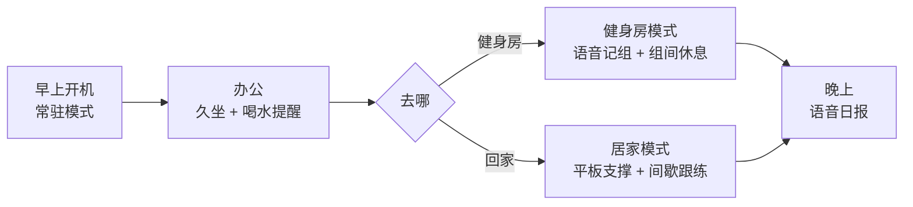
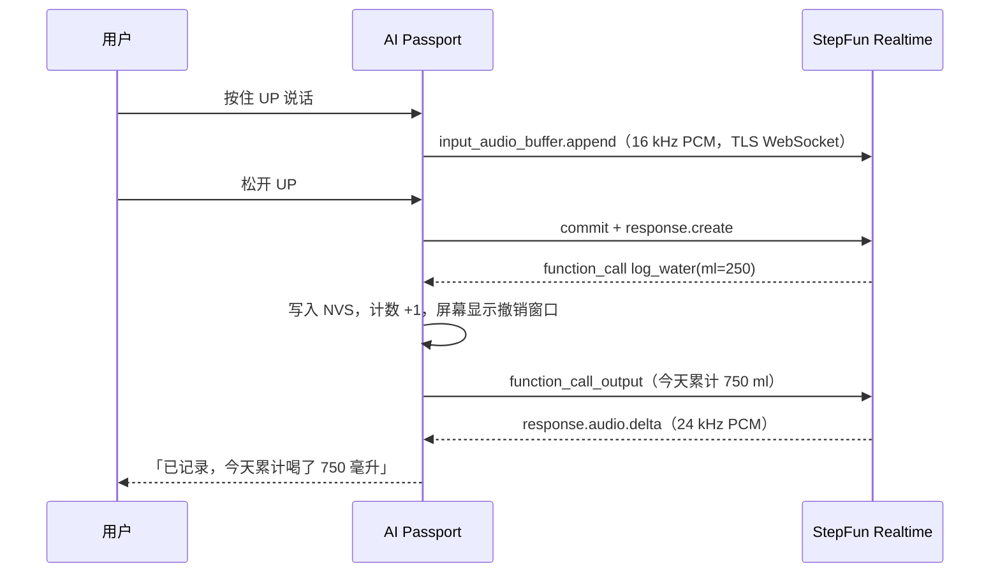

  <strong>简体中文</strong> · <a href="health-companion.md">English</a>

# 随身健康助手：产品形态与设计

AI Passport 挂在胸前或放在桌上，全天常驻：办公时管久坐和喝水，去健身房记组数和组间休息，在家带你做居家训练。按住按键说话，阶跃星辰 StepAudio 3 实时语音模型听懂、回答，并直接改设备状态。

## 创新点

- 模型直接驱动硬件：StepAudio 3 不只聊天，通过 tool call 改设备状态（喝水计数、休息倒计时、训练记录）。设备先写入 Flash，再把结果回传模型，模型播报的是设备上的真实数据。
- 健身房一句话记组：手上拿着器械也能说「卧推 60 公斤 8 个」完成结构化记录，不用掏手机点表格。
- 设备直连云端：ESP32-C3 通过 TLS WebSocket 直接连 StepFun Realtime API，不需要电脑或服务器中转，有网就能用。
- 无 PSRAM 也能跑实时语音：TLS 记录分片、TCP 窗口、Wi-Fi 缓冲按 C3 的 400 KB SRAM 逐项调优。
- 按住说话替代唤醒词，适配无 PSRAM 的芯片和 500 mAh 电池。断网时计时和手动记录照常可用。

## Step 模型使用情况

| 模型 | 用途 | 接口 |
| --- | --- | --- |
| `stepaudio-3-realtime-preview` | 语音理解、语音回复、tool call 驱动设备动作、晚间语音日报 | Realtime API，`wss://api.stepfun.com/v1/realtime` |
| `step-audio-2` | 备用模型，协议相同，只换模型名 | 同上 |

## 技术方案

- 固件：ESP-IDF 5.5.3，FreeRTOS 多任务；UI 用 LVGL 在 240 × 320 屏上自绘；记录以带版本的 blob 写入 NVS。
- 状态机：常驻、健身房、居家三种模式各自一个状态机，计时、提醒和记录逻辑独立于 ESP-IDF 和 LVGL，用 host tests 覆盖。
- 配网：首次开机设备开热点，手机打开 `192.168.4.1` 填 Wi-Fi 和 StepFun API Key；设备先验证 Key 再存进 NVS。固件里不编进任何密钥。
- 语音管线：录音 16 kHz PCM 按块 base64 上传；下行 24 kHz PCM 边收边解析，不缓存整条消息，在设备上重采样到 16 kHz 播放，带预缓冲和淡入淡出。
- 内存：mbedTLS 静态缓冲 + Max Fragment Length（发 4 KB / 收 8 KB），TCP 窗口 8 KB，Wi-Fi 关闭 IRAM 优化，把堆留给音频和 TLS。

联网、配网和语音管线基于开源项目 [Qoder-Passport](https://github.com/kunlun322/Qoder-Passport)（MIT），协议层改为 StepFun Realtime 事件和工具调用。

## 一天怎么用

模式由用户切换，设备不自动判断你在哪。原因见后文「硬件边界」。

## 当前固件怎么操作

这一节是现在烧进设备的按键和状态。后文是产品设想，两边不一致时以这一节为准。用眼提醒、安静时段、晚间语音日报这版还没有。

### 开机和配网

开机优先使用未入库的 `sdkconfig.local`：Wi-Fi 名称、密码和 StepFun Key 都在里面，直接连接，不用在手机上再填。这份配置为空、NVS 里也没有时，才打开热点 `HealthBuddy`。配网页面忽略全部按键。

### 三个模式

菜单标题是「随身健康助手」。下键下一项，确定键进入。短按上键也会上移一项，但按下瞬间会开始录音，松手才结束，所以只想移动选项时用下键。除了居家页，按住上键说话，松开发送。除了菜单，长按确定约 0.5 秒回到菜单。

| 页面 | 确定（单击） | 下键（单击） | 上键 |
| --- | --- | --- | --- |
| 菜单 | 进入当前项 | 下一项 | 短按上移；按住说话 |
| 办公 | 我起来了，久坐计时归零 | 记 250 ml；5 秒内再按则撤销这一次 | 按住说话 |
| 健身房 | 开始或重开 90 秒组间休息 | 5 秒内撤销刚记下的一组或一杯水 | 按住说话 |
| 居家 | 交给平板支撑，按下即生效 | 交给平板支撑 | 交给平板支撑，此页不能说话 |

居家页的平板支撑沿用原来的三态：等待开始时确定键进入约 4 秒准备，下键看历史，上键切换提示音（有未存记录时改为重试保存）；准备中任意键取消；计时中任意键结束并保存。长按确定回菜单时，按下的那一下已经交给计时器，所以可能先开始或结束一次计时。离开居家页后计时不再向前走，回到这一页才继续。

办公页到点才提醒：距上次确认起身 45 分钟，或距上次记水 60 分钟，各响一声，屏幕分别显示「该起来走走」「该喝水了」。推迟只能说出来，例如「十分钟后再提醒」；没说分钟数按 10 分钟，最长 180 分钟。下键不能推迟。

健身房里说「卧推 60 公斤 8 个」会记一组，并自动开始 90 秒休息。动作名不能空，次数 1–100，重量不超过 500.0 kg，最多留 12 组。说「休息两分钟」按 1–600 秒计，0 秒或超过 600 秒都用 90 秒。记水接受 1–2000 ml。

跟练只能用语音开始，例如工作、休息和轮数。工作 1–600 秒，休息 0–600 秒，轮数 1–40。到点响一声并切到下一阶段；休息为 0 时做完一轮直接下一轮。屏幕只显示第几轮和「运动」或「休息」。

喝水毫升数或训练组数变化时写入 NVS。时钟还没对上时日期保持 0，累计值跨天不清空；对时成功并且日期变化后，喝水和训练组清零。时区是东八区。断网时菜单、手动记水、确认起身、休息计时和平板支撑仍然可用。

## 常驻模式：久坐和喝水

默认模式，屏幕显示今天的喝水杯数、距离上次起身的时间和下一次提醒。

- 久坐：默认每 45 分钟提醒一次，响一声并亮屏显示「起来走两分钟」。按 OK 表示已起身，计时归零；按 DOWN 推迟 10 分钟。设备没有运动传感器，「起身」靠用户确认。
- 喝水：按固定间隔提醒，按 OK 记一杯；也可以说「刚喝了半瓶」，模型换算后记录毫升数。
- 用眼：可选 20-20-20 提醒，每 20 分钟提示看远处 20 秒。
- 安静时段：午休、会议和夜间不提醒。
- 提醒只响一次，不连环催促；没响应就在屏幕上留标记，晚上日报里汇总。

## 健身房模式：说一句，记一组

健身房里手上有器械、戴着手套，按一下键说话比在手机上点表格快。

- 记组：按住 UP 说「卧推 60 公斤 8 个」，模型通过 function call 输出结构化记录 `{动作, 重量, 次数}`，设备立即保存，屏幕显示 5 秒「已记录 · DOWN 撤销」。
- 组间休息：保存后自动开始休息倒计时，默认 90 秒，结束前 10 秒提示。也可以直接说「休息两分钟」。
- 查询：「我上次深蹲多重」「今天练了几组」，模型查本地记录后语音回答。
- 离线兜底：没有网络时休息计时和手动记组照常可用。

## 居家模式：平板支撑和间歇跟练

- 平板支撑：自由开始、随时结束，四拍发车提示音进入计时，每 10 秒节奏提示；最近 20 条记录写入 NVS，断电保留。详见[平板支撑自由计时器](plank-trainer.md)。
- 间歇跟练：选「30 秒运动 / 15 秒休息 × 8 轮」这类计划，设备用提示音和屏幕倒计时带节奏，不需要盯手机。
- 语音教练：训练中按住键问「还剩几轮」「换个简单点的」，模型调整当前计划。教练只管节奏和计划，不判断动作是否标准，也不提供医疗建议。

## 语音交互：按住说话，StepAudio 3 回答

交互方式是 push-to-talk：按住 UP 说话，松开结束。ESP32-C3 没有 PSRAM，常开唤醒词会长期占用 CPU 和内存，也更耗电；按键说话省电，也不会误唤醒。

模型是阶跃星辰的 [StepAudio 3 Realtime](https://platform.stepfun.com/docs/zh/guides/models/stepaudio-3-realtime)，接口是[双向实时语音 Realtime API](https://platform.stepfun.com/docs/zh/api-reference/realtime/chat)：

- `session.update` 设置健康助手人设 `instructions`、音色和设备工具。
- 按住 UP 期间持续 `input_audio_buffer.append`，松开后 `input_audio_buffer.commit` + `response.create`；不开 server VAD。
- 收到 `response.function_call_arguments.done` 后设备执行动作并写入 NVS，等 `response.done` 再回传 `function_call_output` 并请求下一次回复。
- `response.audio.delta` 流式播放。

设备端工具：

| 工具 | 作用 |
| --- | --- |
| `log_water(ml)` | 记录喝水量 |
| `log_set(exercise, weight_kg, reps)` | 记录一组力量训练 |
| `start_rest_timer(seconds)` | 开始组间休息倒计时 |
| `start_interval_plan(work_s, rest_s, rounds)` | 开始居家间歇跟练 |
| `snooze_reminder(kind, minutes)` | 推迟久坐或喝水提醒 |
| `query_today(metric)` | 查询今日喝水、起身、训练数据 |

模型负责听懂和说话，状态与记录由设备上的状态机和 NVS 持有。工具调用立即执行，屏幕给 5 秒撤销窗口；模型等设备回传结果后才开口，所以播报内容与设备记录一致。

晚间日报用同一个 Realtime 会话生成：设备把当天的结构化记录作为文本消息发给模型，模型直接语音播报几句总结，屏幕同步显示。

### 链路

## 硬件边界

依据[产品规格](hardware-design/specifications.zh_CN.md)：

| 硬件 | 用法 | 限制 |
| --- | --- | --- |
| 240 × 320 彩屏 | 计时、提醒、撤销卡片 | 小屏只放一个主信息 |
| 上 / 下 / 确定三键 | 模式切换、确认、按住说话 | 没有触摸 |
| 麦克风 + 扬声器（ES8311） | 语音输入、回复播放、提示音 | 嘈杂环境需要靠近说话 |
| Wi-Fi 2.4 GHz | 直连 StepFun、配网热点 | 不支持 5 GHz；健身房没有 Wi-Fi 时用手机热点 |
| NFC（被动 NTAG213） | 手机碰一碰打开日报 | 设备不能读取外部 NFC 标签 |
| 500 mAh 电池 | 全天常驻 | 语音会话按需建立，结束后断开以省电 |

设备没有加速度计或心率传感器，所以不做自动久坐检测、计步、心率和动作识别；后续通过 BLE 接手环或手机数据补充。

## 健康与隐私

- 只提醒和记录，不诊断，不给医疗或康复建议。
- 喝水、训练记录只存设备 NVS；上传给模型的只有当次语音和必要的当天汇总。
- 不保存原始录音。
- API Key 只存在设备 NVS，不进固件和仓库，日志不打印。

## 下一步

- BLE 接手环数据，补充计步和心率。
- NFC 碰一碰在手机上查看周报和趋势。
- 按个人习惯自动调整提醒间隔。
