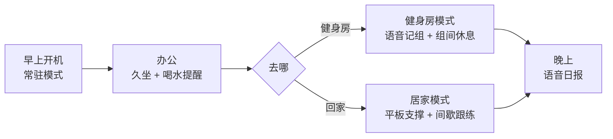
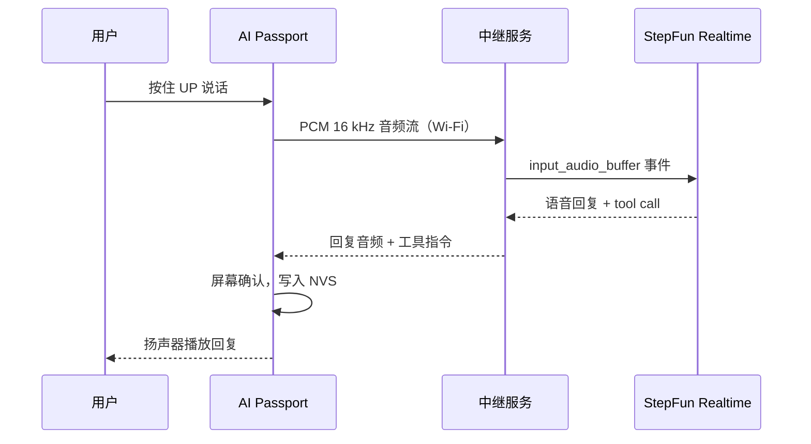

  <strong>简体中文</strong> · <a href="health-companion.md">English</a>

# 随身健康助手：产品形态与设计

AI Passport 挂在胸前或放在桌上，全天常驻：办公时管久坐和喝水，去健身房记组数和组间休息，在家带你做居家训练。按住按键说话，阶跃星辰 Step 实时语音模型听懂、回答，并直接改设备状态。

## 一天怎么用

模式由用户切换，设备不自动判断你在哪。原因见后文「硬件边界」。

## 常驻模式：久坐和喝水

默认模式，屏幕显示今天的喝水杯数、距离上次起身的时间和下一次提醒。

- 久坐：默认每 45 分钟提醒一次，响一声并亮屏显示「起来走两分钟」。按 OK 表示已起身，计时归零；按 DOWN 推迟 10 分钟。设备没有运动传感器，「起身」靠用户确认。
- 喝水：按固定间隔提醒，按 OK 记一杯；也可以说「刚喝了半瓶」，模型换算后记录毫升数。
- 用眼：可选 20-20-20 提醒，每 20 分钟提示看远处 20 秒。
- 安静时段：午休、会议和夜间不提醒。
- 提醒只响一次，不连环催促；没响应就在屏幕上留标记，晚上日报里汇总。

## 健身房模式：说一句，记一组

健身房里手上有器械、戴着手套，按一下键说话比在手机上点表格快。

- 记组：按住 UP 说「卧推 60 公斤 8 个」，模型通过 function call 输出结构化记录 `{动作, 重量, 次数}`，屏幕显示确认卡片，OK 保存，DOWN 撤销。
- 组间休息：保存后自动开始休息倒计时，默认 90 秒，结束前 10 秒提示。也可以直接说「休息两分钟」。
- 查询：「我上次深蹲多重」「今天练了几组」，模型查本地记录后语音回答。
- 离线兜底：没有网络时休息计时和手动记组照常可用，语音记录排队，联网后再解析。

## 居家模式：平板支撑和间歇跟练

- 平板支撑：自由开始、随时结束，四拍发车提示音进入计时，每 10 秒节奏提示；最近 20 条记录写入 NVS，断电保留。详见[平板支撑自由计时器](plank-trainer.md)。
- 间歇跟练：选「30 秒运动 / 15 秒休息 × 8 轮」这类计划，设备用提示音和屏幕倒计时带节奏，不需要盯手机。
- 语音教练：训练中按住键问「还剩几轮」「换个简单点的」，模型调整当前计划。教练只管节奏和计划，不判断动作是否标准，也不提供医疗建议。

## 语音交互：按住说话，Step 实时语音回答

交互方式是 push-to-talk：按住 UP 说话，松开结束。ESP32-C3 没有 PSRAM，常开唤醒词会长期占用 CPU 和内存，也更耗电；按键说话省电，也不会误唤醒。

模型使用阶跃星辰开放平台的[双向实时语音 Realtime API](https://platform.stepfun.com/docs/zh/api-reference/realtime/chat)，WebSocket 地址 `wss://api.stepfun.com/v1/realtime`，模型 `stepaudio-2.5-realtime`：

- 输入输出均为 `pcm16` 音频。
- `session.update` 设置健康助手人设 `instructions` 和音色。
- server VAD 判定说话结束。
- `tools` 函数调用让模型直接触发设备动作。

设备端工具：

| 工具 | 作用 |
| --- | --- |
| `log_water(ml)` | 记录喝水量 |
| `log_set(exercise, weight_kg, reps)` | 记录一组力量训练 |
| `start_rest_timer(seconds)` | 开始组间休息倒计时 |
| `start_interval_plan(work_s, rest_s, rounds)` | 开始居家间歇跟练 |
| `snooze_reminder(kind, minutes)` | 推迟久坐或喝水提醒 |
| `query_today(metric)` | 查询今日喝水、起身、训练数据 |

模型负责听懂和说话，状态与记录由设备上的状态机和 NVS 持有。模型返回的工具调用先在屏幕上确认，再写入记录。

每天的日报和每周回顾由 `step-5-preview` 生成：输入当天的结构化记录，输出几句话总结，在屏幕显示并朗读。

### 链路

设备不直连 StepFun，中间有一个中继服务：

- API Key 留在服务端，不烧进固件，也不进仓库。
- 设备只录放 16 kHz，与模型之间的采样率转换由中继完成。
- C3 启动后空闲堆约 200 KB，TLS 加音频缓冲吃紧；中继同时负责断线重连和会话记录。
- 中继可以跑在手机或电脑上，不依赖云部署。

## 硬件边界

依据[产品规格](hardware-design/specifications.zh_CN.md)：

| 硬件 | 用法 | 限制 |
| --- | --- | --- |
| 240 × 320 彩屏 | 计时、提醒、确认卡片 | 小屏只放一个主信息 |
| 上 / 下 / 确定三键 | 模式切换、确认、按住说话 | 没有触摸 |
| 麦克风 + 扬声器（ES8311） | 语音输入、回复播放、提示音 | 嘈杂环境需要靠近说话 |
| Wi-Fi、BLE 5 | 连中继、手机配网 | 健身房没有 Wi-Fi 时用手机热点 |
| NFC（被动 NTAG213） | 手机碰一碰打开日报 | 设备不能读取外部 NFC 标签 |
| 500 mAh 电池 | 全天常驻 | 语音和 Wi-Fi 按需连接以省电 |

设备没有加速度计或心率传感器，所以不做自动久坐检测、计步、心率和动作识别；后续通过 BLE 接手环或手机数据补充。

## 健康与隐私

- 只提醒和记录，不诊断，不给医疗或康复建议。
- 喝水、训练记录默认只存设备 NVS；上传给模型的只有当次语音和必要的当天汇总。
- 不保存原始录音。
- 日志和演示材料不包含 API Key、设备二维码和个人数据。

## 下一步

- BLE 接手环数据，补充计步和心率。
- NFC 碰一碰在手机上查看周报和趋势。
- 按个人习惯自动调整提醒间隔。
